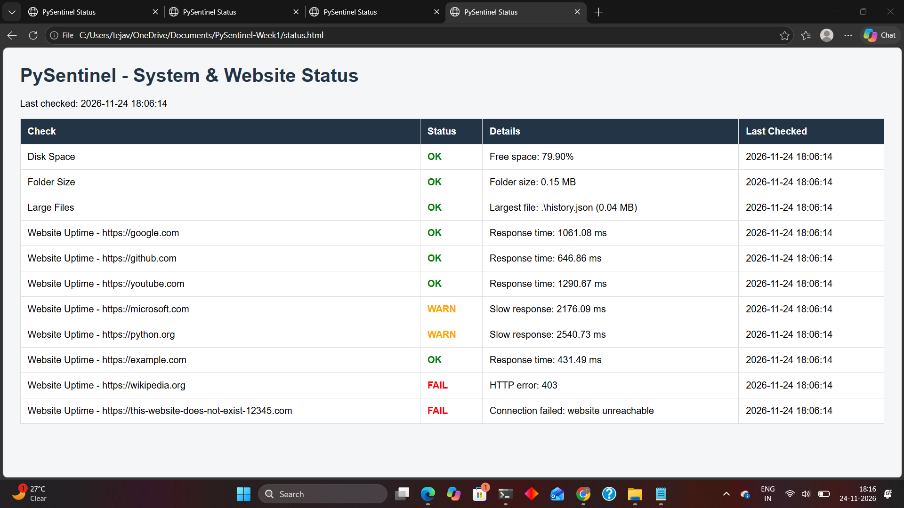
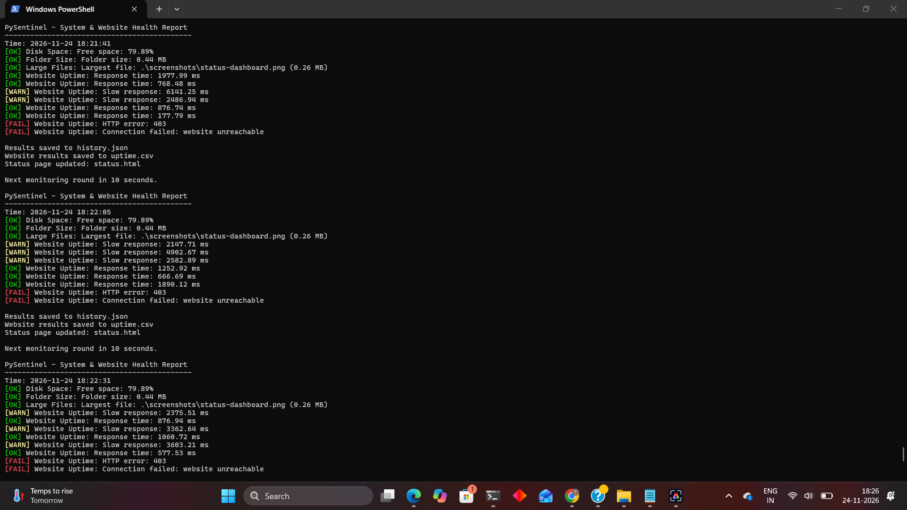

# PySentinel - Automated System & Website Monitor

PySentinel is a Python-based monitoring project that tracks system health and website availability. It uses object-oriented programming, configurable monitoring thresholds, HTTP requests, alerts, automated testing, and CSV/JSON reporting.

## Week 1 - System Health Snapshot

### Features
- Checks total, used, and free disk space.
- Calculates folder sizes.
- Finds the top 5 largest files.
- Displays readable file sizes.
- Saves health reports to a log file.

### Run
```bash
python monitor.py
```

## Week 2 - Configurable System Monitor

### Features
- Uses an object-oriented `Check` base class.
- Includes `DiskSpaceCheck`, `FolderSizeCheck`, and `LargeFileCheck`.
- Loads monitoring thresholds from `config.json`.
- Reports OK, WARN, and FAIL statuses.
- Displays coloured terminal output.
- Saves monitoring results in `history.json`.
- Retains the latest 50 monitoring runs.
- Provides a failure summary using `--summary`.

### Run
```bash
python main.py
```

### View Failure Summary
```bash
python main.py --summary
```

## Week 3 - Automated Website Monitoring & Uptime Reports

### Features
- Monitors multiple websites using the `requests` library.
- Checks HTTP response status codes.
- Measures website response time in milliseconds.
- Detects slow website responses.
- Handles connection errors and request timeouts.
- Records website monitoring results in `uptime.csv`.
- Calculates website uptime percentages.
- Calculates average website response times.
- Displays website uptime reports.
- Continues monitoring even when a website fails.

### Website Configuration

Websites are configured in `config.json` using the `sites` list.

### View Website Uptime Report
```bash
python main.py --report
```

### Run Complete Monitoring
```bash
python main.py
```

## Week 4 - Scheduled Monitoring, Alerts and Automated Tests

### Features
- Runs continuous monitoring in watch mode.
- Supports a configurable monitoring interval.
- Tracks consecutive failures for each check.
- Generates an alert after two consecutive failures.
- Detects and logs recovery when a failed check works again.
- Displays alerts in the terminal.
- Saves alert history in `alerts.log`.
- Generates an HTML status dashboard.
- Displays OK, WARN, and FAIL statuses with colours.
- Automatically refreshes the HTML dashboard every 60 seconds.
- Uses pytest for automated testing.
- Uses mocking to test website failures without real internet requests.

### Start Watch Mode

Run monitoring every 60 seconds:
```bash
python main.py watch --every 60
```

Run monitoring every 10 seconds for testing:
```bash
python main.py watch --every 10
```

Press `Ctrl + C` to stop monitoring.

### View the Status Dashboard

Watch mode automatically opens `status.html` in your browser.

You can also open it manually:
```powershell
start status.html
```

### View Alert Logs
```powershell
Get-Content alerts.log
```

### Run Automated Tests

Install dependencies:
```bash
python -m pip install -r requirements.txt
```

Run all tests:
```bash
python -m pytest -v
```

## Project Screenshots

### System Status Dashboard



### Website Monitoring Watch Mode



## Configuration

Monitoring settings and website URLs are stored in `config.json`.

Example:
```json
{
    "min_free_percent": 20,
    "max_folder_mb": 500,
    "max_file_mb": 100,
    "folders_to_watch": ["."],
    "sites": [
        "https://google.com",
        "https://github.com",
        "https://python.org"
    ]
}
```

## Project Files

- `monitor.py` - Week 1 system health monitor.
- `health_log.txt` - Week 1 health report log.
- `checks.py` - Monitoring classes for system and website checks.
- `config.py` - Loads configuration settings.
- `config.json` - Stores monitoring thresholds and website URLs.
- `main.py` - Runs monitoring checks, watch mode, and reports.
- `main_week3_backup.py` - Backup of the previous main.py.
- `alerts.py` - Handles failure alerts and recovery messages.
- `alerts.log` - Stores alert and recovery records.
- `test_pysentinel.py` - Automated pytest test cases.
- `manual_requests_demo.py` - Manual requests demonstration script.
- `history.json` - Stores the latest 50 monitoring runs.
- `uptime.csv` - Stores website uptime and response-time records.
- `status.html` - Generated HTML monitoring dashboard.
- `requirements.txt` - Lists required Python packages.

## Technologies Used

- Python
- Requests
- Pytest
- unittest.mock
- CSV
- JSON
- os
- shutil
- datetime
- time
- webbrowser
- Object-Oriented Programming

## Learning Journey

- **Week 1:** System Health Snapshot
- **Week 2:** Configurable System Monitor
- **Week 3:** Automated Website Monitoring & Uptime Reports
- **Week 4:** Scheduled Monitoring, Alerts and Automated Tests